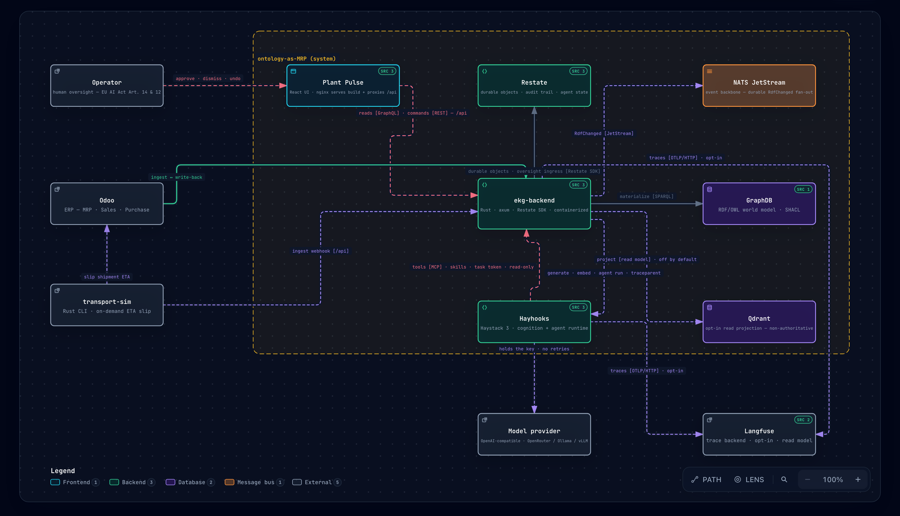

# ontology-as-MRP

A lightweight, **full-Rust** demonstrator of a governed enterprise knowledge
graph in which **agents operate inside the world model (OWL) itself**, reasoning
over typed, governed entities and acting through governed verbs, rather than
one-off task bots.

## Core idea: three layers preserved

- **Semantic**: the world model: typed governed objects/links in an RDF/OWL
  triple store. *What things are and how they relate.*
- **Kinetic**: governed action types (verbs) that write back under policy.
  *How the world is changed: AI proposes, promotion is separate.*
- **Dynamic**: durable monitors and agent loops that keep the world on plan and
  raise action points when it drifts. *The operational feedback loop.*

The value is cross-department grounding, not a siloed point tool.

## A point of view on agentic enterprise systems

Most enterprise AI still sits *beside* the business: a chat window over documents, a
copilot inside one tool, a task bot that fires and forgets. We think the durable step is
agents that work **inside** the enterprise's own model of itself (the same typed orders,
parts, suppliers and machines the business runs on) and change it only through the same
governed verbs a person would use. This repository is a small, working argument for that
view, not a product.

- **The world model is the shared ground.** Every fact carries its source, so a plan an
  agent proposes is grounded in the same graph a planner reads, across departments.
- **Verbs, not free-form writes.** An agent never edits a system of record. It proposes
  plans made of governed action types, each reversible and each validated before it runs.
- **Autonomy is a policy, not a prompt.** What may happen without a person is decided by a
  human-authored policy with explicit criteria, and everything else waits for a human
  (EU AI Act Art. 14).

### How work enters and flows

1. **A change lands in a system of record**: an order is placed, a shipment slips.
2. **It is materialized into the world model** with provenance, and the change is
   published as an event.
3. **A deterministic rule** decides whether a promise is at risk and opens an *action
   point*. No model sits in the detection path.
4. **The agent proposes, simulates and ranks plans** over the same graph, coupling points
   that share a cause (an order and the manufacturing orders that fulfil it) into one plan.
5. **The policy applies what is safe** (allowlisted, reversible, within a cost limit, no
   promised-date move, supplier confirmed) **and a human approves the rest**.
6. **The change is written back through a governed verb**, audited end to end and undoable
   within its window, and the source re-ingests, which closes the loop.

### The two oversight paths

A fresh local stack ([starter cases](./deploy/podman/local/README.md#starter-cases)) shows
the operator's day from both sides:

- **Plans that wait for a human**, each with the policy criteria it fails: a joint plan
  across coupled orders and a busy assembly line, a single short order, and a split
  manufacturing order.
- **Changes the agent applied under policy**, each with the criteria it met and an undo:
  a gear-set expedite and a frame reconfirm.

## Flagship use cases

A deterministic monitor watches the world model and opens a governed **action point** for
every order that is off plan. The agent then proposes plans for the open action points and
simulates each one before a person sees it. Action points that share a cause (a sales order
and the manufacturing order that fulfils it) are planned together, so one plan can settle
several action points.

- **Delivery promise and supply risk.** A sales order whose components cannot arrive in
  time: the monitor follows `SalesOrder → BOM → Component → Supplier → PurchaseOrder →
  StockLevel`, plus a live transport/ETA signal, and flags the order when the only inbound
  is late or too small. Plans expedite a purchase order, split the build or move the
  promised date.
- **Manufacturing capacity.** A manufacturing order whose work orders contend for a work
  centre, or cannot finish inside their planned window. Plans reschedule a work order,
  reassign it to another work centre or raise the work centre's capacity.

## Stack

| Layer             | Choice                                                                               |
| ----------------- | ------------------------------------------------------------------------------------ |
| Semantic store    | GraphDB (graphwise/Ontotext): RDF/OWL world model, SHACL validation, KG viz          |
| Engine and API    | `ekg-backend` (Rust, axum, Restate SDK): ingestion, GraphQL reads and REST commands behind `/api` |
| Durable runtime   | Restate (durable execution, audit trail and the agent's durable state)               |
| Event backbone    | NATS JetStream: `RdfChanged` fan-out to independent consumers                        |
| Cognition         | Haystack (Hayhooks) pipelines over an OpenAI-compatible endpoint (OpenRouter by default; Ollama, vLLM and others swappable) |
| Agent tools       | An MCP tool gateway in the backend: read-only, one task token per agent run          |
| Governed truth    | Source systems of record (Odoo, …) and the RDF world model; no separate store        |
| Source systems    | Odoo (primary) and `transport-sim`, a Rust shipment simulator (transport/ETA); Postgres backs Odoo only |
| Vector projection | Qdrant, optional and off by default; a read model, never authoritative               |
| Traces            | OpenTelemetry to Langfuse, optional; nothing is read back from it                    |
| Local infra       | Podman (Docker alternative)                                                          |
| API contract      | Generated from the code: an OpenAPI 3.1 document for commands, a GraphQL schema for reads |
| Frontend          | Plant Pulse: React + TypeScript + Vite, served by nginx, which also proxies `/api`   |

## Architecture

Data flows in from the systems of record, is materialized into the governed RDF
world model, and every change is published as an event. A **deterministic**
monitor decides risk; a **bounded agent** only ever *proposes*; a promotion (by a
**human**, or by a **human-authored policy** within its criteria) is the only path to
a governed write-back, which re-ingests and closes the loop.

The whole governed loop at a glance, as a **C4 container view** (click to explore the
interactive version):

[](https://krapluka.github.io/ontology-as-MRP/architecture/ekg-system.architecture.html)

**Flow:** Odoo notifies `ekg-backend` (thin webhook), which fat-pulls and `materialize`s
into GraphDB with provenance. The backend publishes `RdfChanged` on NATS, a deterministic
monitor decides risk and a bounded agent only ever *proposes*. A promotion (a human,
or the auto-apply policy within its criteria) is the only path to a governed write-back
into Odoo, which re-ingests and closes the loop.

**Governance invariants:** AI never autonomously commits governed change (propose,
then promote); every write-back is a governed action type with provenance and is
reversible; promotion requires meaningful human oversight with an audit trail: a
human approves the plan, or a human-authored policy applies it within its criteria;
read-model projections (vector, KG-viz) are never authoritative; cognition is
provider-neutral.

## Getting started

```bash
git clone https://github.com/krapluka/ontology-as-MRP.git
cd ontology-as-MRP

just bootstrap          # dev tools + git hooks, then `just doctor`
cargo build --workspace
cargo test --workspace

cp .env.example .env    # then set MODEL_API_KEY (OpenRouter) etc.; .env is gitignored
```

Run the local substrate (GraphDB, Restate, NATS, Qdrant, Hayhooks, Postgres, Odoo) with
Podman, in one self-provisioning command (see
[deploy/podman/local/README.md](./deploy/podman/local/README.md)):

```bash
just podman-local-up
```

## Evaluate the agent

`evals/agent/` holds a versioned set of fixed cases for the tool-using planning agent. Each
case is a small world with one subject off plan; the agent is run on it several times and
every run is graded by the engine and the what-if simulator, never by a model.

```bash
just podman-build && podman compose -f deploy/podman/local/compose.yaml up -d graphdb
just agent-eval            # every case, 3 trials each, against the real model
```

A run needs GraphDB, the runtime image and `MODEL_API_KEY`, and spends model tokens (about
50 agent runs for the whole set; it stops at `EKG_AGENT_EVAL_MAX_TOKENS`). It needs neither
Restate nor Odoo and never touches the stack's data. Neither `just verify` nor `just test-e2e`
runs it; `just verify` only checks that the set, its lock and its dataset card agree.
`evals/agent/README.md` describes the case format and the commands, `evals/agent/DATASET.md`
what the set covers and what it does not.

## API contract

The contract is generated from the backend's code, never written by hand:

- **Commands** are REST. The backend builds an OpenAPI 3.1 document from its own handlers
  (utoipa) and serves it at `GET /api/openapi.json`.
- **Reads** are GraphQL, at `POST /api/graphql`. The surface is read-only: it has no
  mutations.

Snapshots of both (`apps/frontend/openapi.json`, `apps/frontend/schema.graphql`) are committed,
and the tests fail when a snapshot differs from what the code generates. There is no bundled
docs UI; point any OpenAPI or GraphQL client at the endpoints above, see
[openapi/README.md](./openapi/README.md).

## Software bill of materials (SBOM)

A cross-ecosystem SBOM with resolved licenses, organized by crate / app / service,
is generated with [ORT](https://github.com/oss-review-toolkit/ort). The
human-readable report lives at **[`docs/sbom/report.html`](https://krapluka.github.io/ontology-as-MRP/sbom/report.html)**.
Regenerate any time with:

```bash
just sbom
```

This is transparency only, additive and non-gating; `cargo-deny` remains the
supply-chain gate. See [docs/sbom/README.md](./docs/sbom/README.md).

## License

[MIT](./LICENSE).
